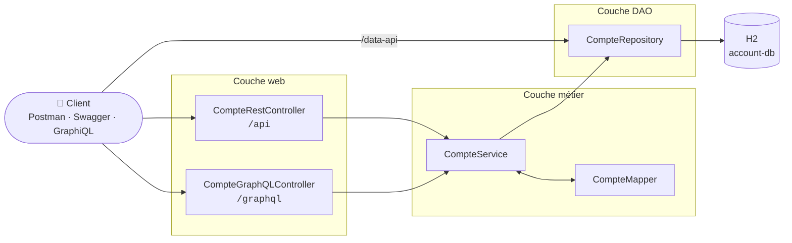
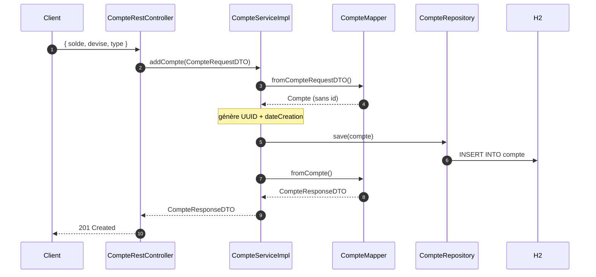
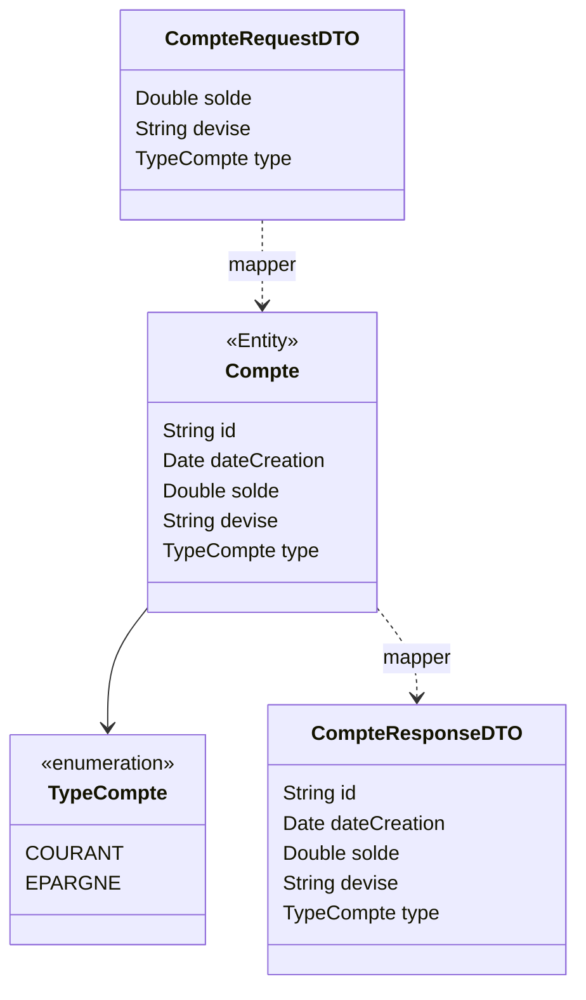

<div align="center">

# 🏦 bank-account-service

### Un compte bancaire. Trois portes d'entrée.

*Un micro-service Spring Boot qui expose la même ressource `Compte` en **REST**, en **Spring Data REST** et en **GraphQL**, construit en 11 étapes, un commit par étape.*


</div>

---

## La même question, posée trois fois

> *« Donne-moi le solde et le type de chaque compte. »*

| Porte | Requête | Ce qui revient |
|---|---|---|
| **REST classique** | `GET /api/comptes` | Tous les champs, toujours. Le serveur décide de la forme. |
| **Spring Data REST** | `GET /data-api/comptes?projection=p1` | Une forme prédéfinie côté serveur (`id`, `solde`, `type`), enveloppée en HAL avec liens et pagination. |
| **GraphQL** | `query { comptes { id solde type } }` | Exactement les champs demandés. C'est le client qui décide. |

Trois philosophies, une seule base de données, une seule couche métier. Tout ce dépôt raconte comment on arrive là.

---

## Architecture



Les deux contrôleurs passent par `CompteService` et ne voient que des DTOs. **Spring Data REST** court-circuite volontairement la couche métier : le repository est exposé directement, ce qui est à la fois sa force (zéro code) et sa limite (aucune règle métier).

### La vie d'une requête `POST /api/comptes`



### Modèle de données



---

## Démarrer en 60 secondes

```bash
git clone https://github.com/Ilyass-Hakim/bank-account-service.git
cd bank-account-service
./mvnw spring-boot:run        # Windows : mvnw.cmd spring-boot:run
```

Au démarrage, 10 comptes aléatoires sont insérés. Ensuite, tout est à portée de clic :

| | URL |
|---|---|
| 🔌 API REST | http://localhost:8081/api/comptes |
| 🧭 Spring Data REST | http://localhost:8081/data-api/comptes |
| 📖 Swagger UI | http://localhost:8081/swagger-ui.html |
| 📄 Spec OpenAPI | http://localhost:8081/v3/api-docs |
| 🔮 GraphiQL | http://localhost:8081/graphiql |
| 🗄️ Console H2 | http://localhost:8081/h2-console (JDBC `jdbc:h2:mem:account-db`, user `sa`, sans mot de passe) |

Une collection Postman prête à importer se trouve dans [`postman/`](postman/). Elle enchaîne création → lecture → modification → suppression en réutilisant automatiquement l'id créé.

---

## Journal de construction

Chaque étape correspond à un commit. Cliquer sur le hash affiche exactement ce qui a changé.

<details>
<summary><b>01 · Socle du projet</b> — <a href="https://github.com/Ilyass-Hakim/bank-account-service/commit/1ae56a7">1ae56a7</a></summary>

<br/>

Projet généré avec Spring Initializr : **Web**, **Spring Data JPA**, **H2**, **Lombok**. Port fixé à `8081`, base H2 nommée `account-db` pour qu'elle soit joignable depuis la console.

> 💡 Avec Spring Boot 4, la console H2 vit dans un module à part : `spring-boot-h2console`. Sans lui, `/h2-console` répond 404.


</details>

<details>
<summary><b>02 · L'entité <code>Compte</code></b> — <a href="https://github.com/Ilyass-Hakim/bank-account-service/commit/e84b60a">e84b60a</a></summary>

<br/>

Une entité JPA avec `id`, `dateCreation`, `solde`, `devise` et `type`.

- **`id` en `String` (UUID)** plutôt qu'un `Long` auto-incrémenté : un identifiant qui ne dépend pas de la base, adapté à un système distribué.
- **`@Enumerated(EnumType.STRING)`** : la base stocke `COURANT`, pas `0`. Lisible, et robuste si l'on réordonne l'enum.
</details>

<details>
<summary><b>03 · Le repository</b> — <a href="https://github.com/Ilyass-Hakim/bank-account-service/commit/4ece0c8">4ece0c8</a></summary>

<br/>

`CompteRepository extends JpaRepository<Compte, String>` : aucune implémentation écrite, Spring la génère. La méthode `findByType` est une *query method* : la requête est déduite de son nom.
</details>

<details>
<summary><b>04 · Test de la couche DAO</b> — <a href="https://github.com/Ilyass-Hakim/bank-account-service/commit/b07a8c8">b07a8c8</a></summary>

<br/>

Un `CommandLineRunner` insère 10 comptes au démarrage, puis exerce `save`, `count`, `findAll` et `findByType` en affichant les résultats dans la console.


</details>

<details>
<summary><b>05 · Web service RESTful</b> — <a href="https://github.com/Ilyass-Hakim/bank-account-service/commit/5f4f84e">5f4f84e</a></summary>

<br/>

| Méthode | Route | Statut |
|---|---|---|
| `GET` | `/api/comptes` | 200 |
| `GET` | `/api/comptes/{id}` | 200 · 404 |
| `POST` | `/api/comptes` | 201 |
| `PUT` | `/api/comptes/{id}` | 200 · 404 |
| `DELETE` | `/api/comptes/{id}` | 204 · 404 |

*Les statuts 201, 204 et 404 sont arrivés à l'étape 10.*
</details>

<details>
<summary><b>06 · Tests avec Postman</b> — <a href="https://github.com/Ilyass-Hakim/bank-account-service/commit/1dbcad8">1dbcad8</a></summary>

<br/>

La collection [`postman/bank-account-service.postman_collection.json`](postman/bank-account-service.postman_collection.json) déroule un cycle de vie complet. Le POST stocke l'id renvoyé dans la variable `compteId`, réutilisée par les requêtes suivantes.


</details>

<details>
<summary><b>07 · Documentation Swagger</b> — <a href="https://github.com/Ilyass-Hakim/bank-account-service/commit/90657a3">90657a3</a></summary>

<br/>

`springdoc-openapi` **3.x**, la branche compatible Spring Boot 4 (la 2.x, citée dans la plupart des tutoriels, ne cible que Spring Boot 3). Les métadonnées de l'API sont définies dans `OpenApiConfig`.


</details>

<details>
<summary><b>08 · Spring Data REST & projections</b> — <a href="https://github.com/Ilyass-Hakim/bank-account-service/commit/66876fc">66876fc</a></summary>

<br/>

Une annotation sur le repository (`@RepositoryRestResource`) suffit à obtenir une API complète, paginée, en HAL, servie sous `/data-api` pour ne pas entrer en collision avec `/api`.

La projection `p1` réduit la réponse à `id`, `solde` et `type` :

```
/data-api/comptes                                         → représentation complète
/data-api/comptes?projection=p1                           → représentation réduite
/data-api/comptes?page=0&size=3                           → pagination
/data-api/comptes/search/byType?type=EPARGNE&projection=p1 → recherche + projection
```


</details>

<details>
<summary><b>09 · DTOs & mapper</b> — <a href="https://github.com/Ilyass-Hakim/bank-account-service/commit/92cbf67">92cbf67</a></summary>

<br/>

- `CompteRequestDTO` : ce que le client **a le droit** d'envoyer. Pas d'`id` ni de `dateCreation` : impossible de les imposer.
- `CompteResponseDTO` : ce que l'API **s'engage** à renvoyer, indépendamment de l'entité JPA.
- `CompteMapper` : conversion dans les deux sens via `BeanUtils.copyProperties`, sans dépendance supplémentaire.
</details>

<details>
<summary><b>10 · Couche métier</b> — <a href="https://github.com/Ilyass-Hakim/bank-account-service/commit/be83b23">be83b23</a></summary>

<br/>

`CompteService` / `CompteServiceImpl` (`@Transactional`) concentrent les règles : génération de l'UUID et de la date, mise à jour partielle, levée de `CompteNotFoundException`.

Un `@RestControllerAdvice` transforme cette exception en **404** au format standard [RFC 9457](https://www.rfc-editor.org/rfc/rfc9457) (`ProblemDetail`) :

```json
{
  "type": "about:blank",
  "title": "Not Found",
  "status": 404,
  "detail": "Compte 3f2a… introuvable",
  "instance": "/api/comptes/3f2a…"
}
```


</details>

<details>
<summary><b>11 · Web service GraphQL</b> — <a href="https://github.com/Ilyass-Hakim/bank-account-service/commit/04a96ad">04a96ad</a></summary>

<br/>

Le schéma [`schema.graphqls`](src/main/resources/graphql/schema.graphqls) déclare 2 queries et 3 mutations. `CompteGraphQLController` les relie à **la même** `CompteService` que le contrôleur REST : aucune logique dupliquée.

```graphql
mutation {
  addCompte(compte: { solde: 30000, devise: "MAD", type: COURANT }) {
    id
    dateCreation
    solde
  }
}
```

Un `DataFetcherExceptionResolverAdapter` traduit `CompteNotFoundException` en erreur GraphQL de type `NOT_FOUND`.


</details>

---

## Décisions techniques

| Décision | Alternative écartée | Pourquoi |
|---|---|---|
| Identifiant UUID `String` | `Long` auto-incrémenté | Généré sans aller-retour en base, unique entre instances. |
| DTOs Request / Response séparés | Exposer l'entité | Le client ne peut pas forger un `id` ; le contrat d'API survit aux évolutions du modèle. |
| Mapper avec `BeanUtils` | MapStruct | Suffisant pour une entité plate, aucune dépendance ni génération de code. |
| `/api` et `/data-api` séparés | Un seul préfixe | Les deux styles cohabitent sans conflit de routes et restent comparables. |
| Erreurs en `ProblemDetail` | Message texte ou 500 | Format standardisé, lisible par n'importe quel client HTTP. |
| H2 en mémoire | MySQL / PostgreSQL | Zéro installation pour un TP ; changer de SGBD ne touche que `application.properties`. |

---

## Arborescence

```
src/main/java/org/hakim/bankaccountservice
├── BankAccountServiceApplication.java   ← jeu de données au démarrage
├── config/        OpenApiConfig
├── dto/           CompteRequestDTO · CompteResponseDTO
├── entities/      Compte · CompteProjection
├── enums/         TypeCompte
├── exceptions/    CompteNotFoundException
├── mappers/       CompteMapper
├── repositories/  CompteRepository
├── service/       CompteService · CompteServiceImpl
└── web/           CompteRestController · CompteGraphQLController
                   GlobalExceptionHandler · GraphQLExceptionHandler

src/main/resources
├── application.properties
└── graphql/schema.graphqls
```

---

## Et après ?

- [ ] Validation des entrées (`@Valid`, `@Positive` sur le solde)
- [ ] Tests automatisés : `@DataJpaTest` pour le repository, `@WebMvcTest` pour le contrôleur, `@GraphQlTest` pour GraphQL
- [ ] Opérations métier : débit / crédit / virement avec contrôle de solde
- [ ] Intégration dans une architecture micro-services : Eureka, Gateway, Config Server

---

<div align="center">
<sub>Réalisé par <b>Ilyass Hakim</b> · TP Architecture Micro-services · Spring Boot 4 / Java 25</sub>
</div>
